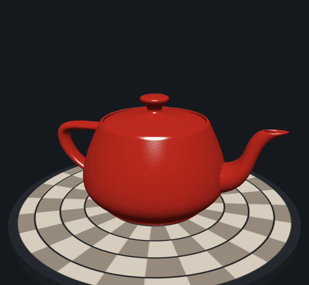
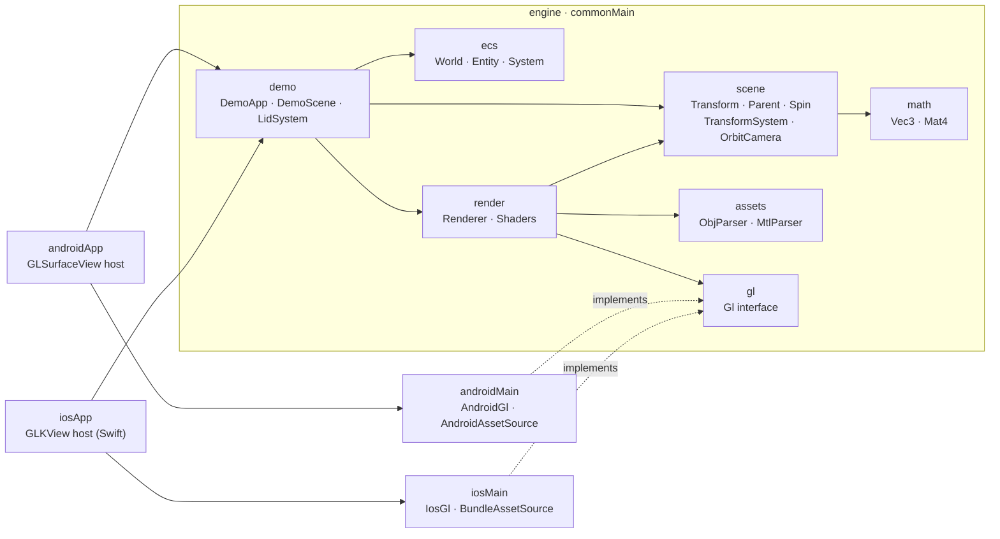
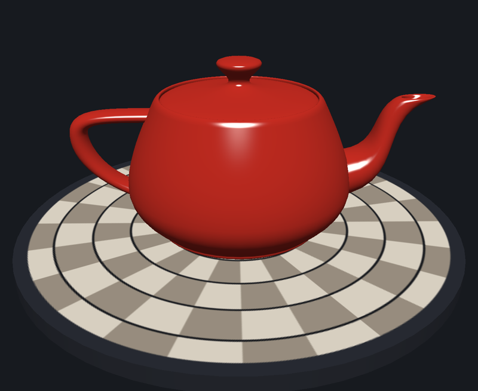
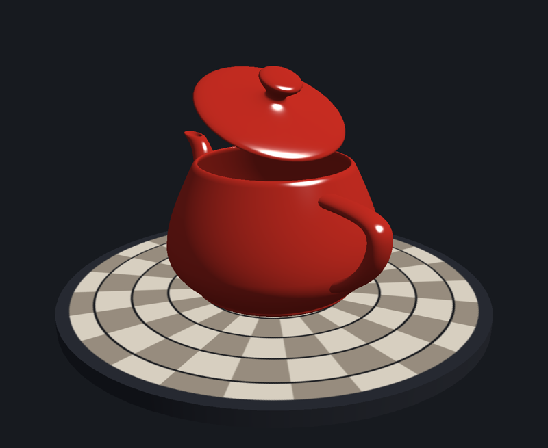

# kmp-gl-renderer

A small OpenGL ES 3 renderer and entity-component system written in **Kotlin Multiplatform**.
The engine, scene, OBJ/MTL loaders, math and the whole renderer are common Kotlin;
Android and iOS each contribute only a thin GL binding and an asset reader.

<p align="center"></p>

The demo is the Utah teapot on a spinning turntable. Drag to orbit, pinch to zoom, double-tap to open the lid.
The lid is a child entity of the teapot, which is a child of the turntable, so it rides along while it animates.

## Features

- **Shared renderer** — per-pixel Blinn-Phong with a key light and a sky/ground hemisphere fill, lit in linear space;
  diffuse textures with mipmaps; transparent materials drawn back to front after the opaque pass;
  double-sided shading for open meshes.
- **Entity-component system** — entities are bags of plain data components; systems (spin, animation,
  transform hierarchy) run in order each frame. World matrices are resolved through any depth of `Parent` links,
  with cycle detection.
- **Asset pipeline** — OBJ (polygons, all index forms, negative indices, `usemtl` splits, generated face normals)
  and MTL readers that work on plain text, so they are unit-tested without a device.
  Each mesh is uploaded to the GPU once as an interleaved VBO in a VAO.
- **Two platforms, one GL interface** — `Gl` is a ~25-method interface implemented with `GLES30` on Android
  and Kotlin/Native's `platform.gles3` bindings on iOS.

## Architecture



Each frame the host calls `DemoApp.drawFrame(time)`: the `World` runs its systems
(spin → lid animation → transform hierarchy), then `Renderer` draws every entity with a `ModelRef`.
Input is forwarded on the GL thread (`queueEvent` on Android; GLKit already draws on the main thread).

| Android | Lid open |
|---|---|
|  |  |

## Building

**Android** — JDK 17+ and the Android SDK:

```sh
./gradlew :androidApp:installDebug
```

**iOS** — macOS with Xcode and [XcodeGen](https://github.com/yonaskolb/XcodeGen):

```sh
cd iosApp && xcodegen generate && open GLRenderer.xcodeproj
```

The Xcode build runs Gradle to produce the Kotlin `Engine` framework. Apple has deprecated OpenGL ES,
but it still ships and runs on devices and in the simulator.

**Tests** — the engine tests run on the JVM and on the iOS simulator:

```sh
./gradlew :engine:testDebugUnitTest          # any OS
./gradlew :engine:iosSimulatorArm64Test      # macOS
```

On Windows and Linux the iOS sources are still type-checked (`kotlin.native.enableKlibsCrossCompilation`);
only linking the framework needs a Mac. CI builds both apps, runs the tests on both platforms and
uploads a screenshot from the iOS simulator.

## Assets

`assets/` is generated by `python tools/generate_assets.py` (standard library only):
the teapot and lid are tessellated from Martin Newell's 1975 Bézier patch data
(as distributed with three.js), the turntable is a procedural cylinder, and its texture is drawn in code.

## History

Started in 2020 as an experiment in sharing OpenGL code through Kotlin Multiplatform, and grew an ECS and
a model viewer in 2021–22. Rebuilt in 2026 on current Kotlin, AGP and Gradle: GPU buffers uploaded once
instead of every frame, ES 3 throughout, lighting moved to the fragment shader, a pure-Kotlin matrix library,
a real iOS backend, tests and CI.

## License

MIT
