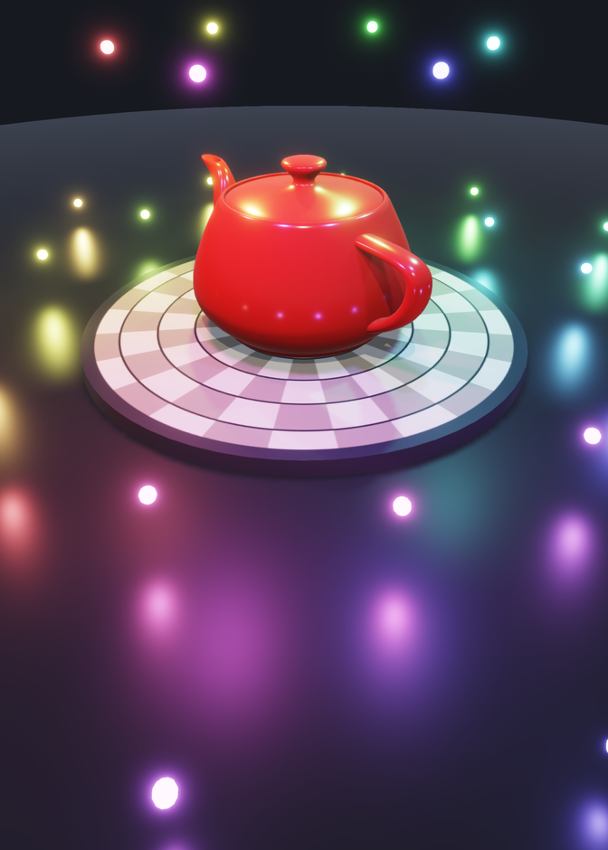
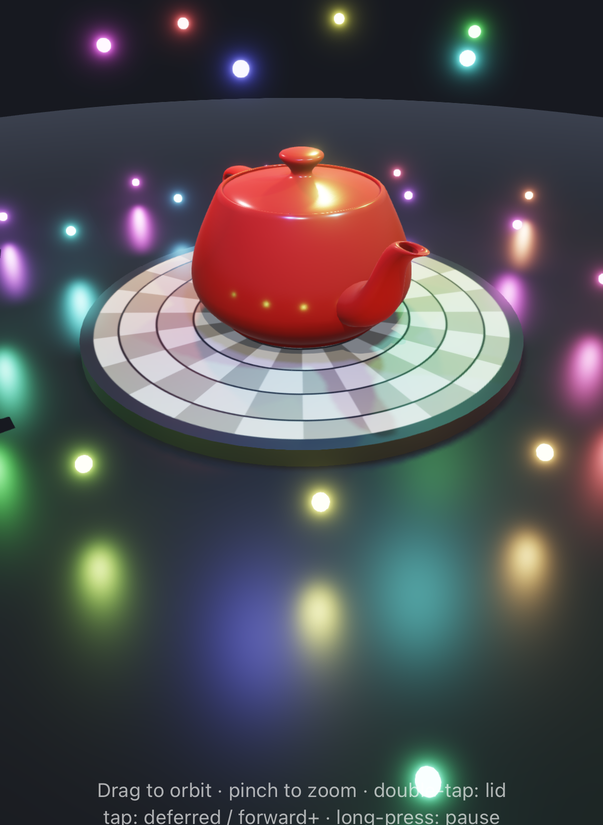
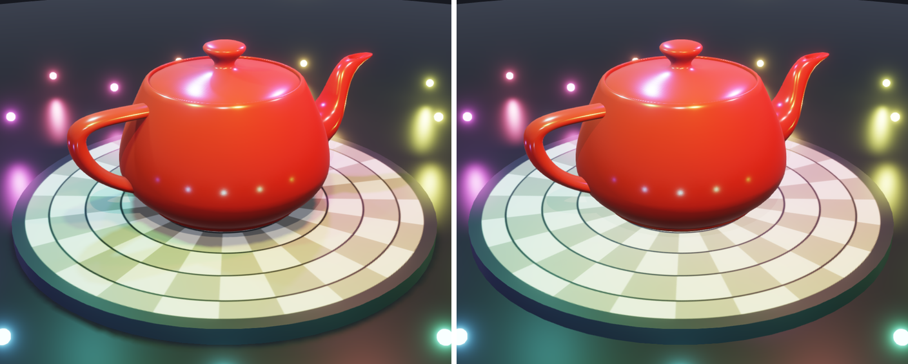
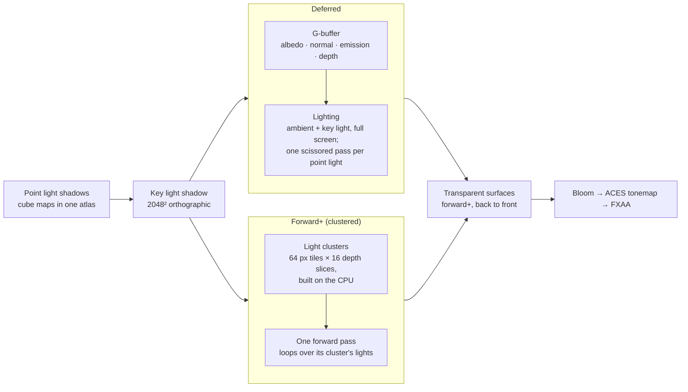
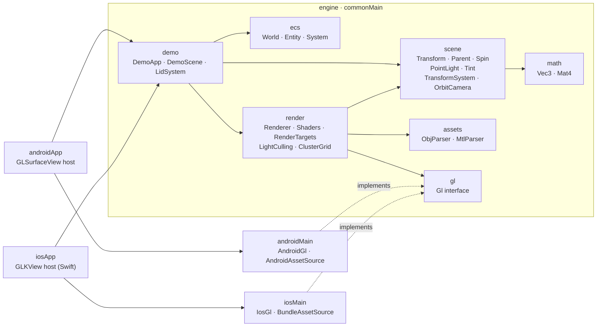

# kmp-gl-renderer

An OpenGL ES 3 renderer and entity-component system written in **Kotlin Multiplatform**, running on Android and iOS
from one codebase: deferred and clustered forward+ pipelines, metal/roughness PBR, shadow maps for the key light and
for point lights, HDR with bloom and tonemapping, FXAA and instancing.
The engine, scene, OBJ/MTL loaders, math and the whole renderer are common Kotlin;
Android and iOS each contribute only a thin GL binding and an asset reader.

<p align="center"></p>

The demo is the Utah teapot on a spinning turntable, circled by three rings of coloured point lights (32 in all);
the six above the teapot cast shadows. Drag to orbit, pinch to zoom, double-tap to open the lid,
tap to switch between the deferred and forward+ pipelines, long-press to pause.

## Screenshots

| Android · deferred | Android · forward+ | iOS simulator · deferred |
|---|---|---|
|  |  |  |

The two pipelines shade with the same GLSL functions and produce the same image: on the paused frame above,
the mean difference is 0.5/255 and no pixel differs by more than 16/255 (the residue is the 8-bit G-buffer).
The iOS screenshot comes from CI, which builds the app, runs it in the simulator and captures a frame.

**Point light shadows**, on and off, same frame. The teapot throws a shadow from each of the six lights above it,
and the turntable shadows the floor around its rim:



## Rendering



- **PBR** — Cook-Torrance (GGX distribution, Schlick-GGX visibility, Schlick Fresnel) with Lambert diffuse;
  metal/roughness materials from the MTL PBR extension (`Pr`, `Pm`, `Ke`), with a fallback from Blinn-Phong `Ns`.
  Ambient is a sky/ground gradient with Karis' analytic split-sum approximation for its specular part.
  Base-colour textures are `SRGB8_ALPHA8`, so filtering happens in linear space.
- **Deferred** — three render targets (√albedo + metallic, normal + roughness, HDR emission) and a depth texture
  that world positions are reconstructed from. Each point light is a full-screen triangle scissored to the screen
  rectangle its sphere of influence projects to, added on with additive blending.
- **Clustered forward+** — the view frustum is cut into 64-pixel tiles × 16 exponentially spaced depth slices, and each
  cluster lists the lights whose screen rectangle and depth range overlap it. ES 3.0 has no compute shaders, so the
  lists are built on the CPU (count, prefix sum, fill) and uploaded as two RGBA32F textures, a per-cluster
  (offset, count) and one compacted index list, so no cluster has a light limit. The fragment shader finds its cluster
  from `gl_FragCoord` and its view depth. The same pass shades transparent surfaces in the deferred path,
  which a G-buffer cannot hold.
- **Exact light bounds** — a light's screen rectangle is the exact bounding box of its sphere's perspective projection,
  solved per screen axis from the lines tangent to the sphere through the eye, with the sphere's cap on the near plane
  taking over when it crosses it. Tests check it against thousands of projected sample points.
- **Key light shadow** — an orthographic shadow map fitted to a bounding sphere, sampled through a `sampler2DShadow`
  with hardware comparison and a 3×3 PCF kernel; slope-scaled polygon offset plus a normal offset against acne.
- **Point light shadows** — lights flagged `castsShadows` (up to 8 visible at once) render six cube faces into one
  depth atlas, a row per light, because ES 3.0 cannot index an array of cube samplers dynamically. The shader picks
  the face by the major axis of the light-to-surface direction and reproduces the face's projection. Faces are rendered
  slightly wider than 90° so 3×3 PCF never samples a neighbouring tile, and each light only draws the instances whose
  bounding sphere reaches into its own.
- **HDR and post-processing** — lighting accumulates in an `RGBA16F` target. Bloom is a five-level mip chain
  (soft-threshold prefilter, 4-tap downsample, tent upsample), followed by exposure, the ACES filmic curve and FXAA.
  If the GPU can't render to half-float (`EXT_color_buffer_half_float`), everything falls back to 8-bit targets
  and the renderer reports `hdr == false`.
- **Instancing** — draws are grouped by mesh; each group is one `glDrawArraysInstanced` with per-instance model
  matrix, normal matrix and tint in a dynamic vertex buffer. The 32 light bulbs are one draw call.

## Engine

- **Entity-component system** — entities are bags of plain data components; systems (spin, animation,
  transform hierarchy) run in order each frame. World matrices are resolved through any depth of `Parent` links,
  with cycle detection. Lights are components (`PointLight`), as is per-instance colour (`Tint`): the lid is a child of
  the teapot, which is a child of the turntable, and each light is a child of its ring.
- **Asset pipeline** — OBJ (polygons, all index forms, negative indices, `usemtl` splits, generated face normals)
  and MTL readers that work on plain text, so they are unit-tested without a device.
  Each mesh is uploaded to the GPU once as an interleaved VBO in a VAO.
- **Two platforms, one GL interface** — `Gl` is a ~40-method interface implemented with `GLES30` on Android
  and Kotlin/Native's `platform.gles3` bindings on iOS. The renderer's tests run against a recording fake of it,
  checking pass order, instancing, shadow budgets and caster culling, clustering and the half-float fallback
  without a GPU.

## Architecture



Each frame the host calls `DemoApp.drawFrame(time)`: the `World` runs its systems
(spin → lid animation → transform hierarchy), then `Renderer` draws every entity with a `ModelRef`,
lit by every entity with a `PointLight`.
Input is forwarded on the GL thread (`queueEvent` on Android; GLKit already draws on the main thread).

## Building

**Android** — JDK 17+ and the Android SDK:

```sh
./gradlew :androidApp:installDebug
```

**iOS** — macOS with Xcode and [XcodeGen](https://github.com/yonaskolb/XcodeGen):

```sh
cd iosApp && xcodegen generate && open GLRenderer.xcodeproj
```

The Xcode build runs Gradle to produce the Kotlin `Engine` framework.

**Tests** — the engine tests run on the JVM and on the iOS simulator:

```sh
./gradlew :engine:testDebugUnitTest          # any OS
./gradlew :engine:iosSimulatorArm64Test      # macOS
```

On Windows and Linux the iOS sources are still type-checked (`kotlin.native.enableKlibsCrossCompilation`);
only linking the framework needs a Mac. CI builds both apps, runs the tests on both platforms and
captures a frame from the iOS simulator.

## Limits

Point light shadows cost six extra passes per light, so they are opt-in per light and capped at eight visible at once.
The renderer targets OpenGL ES 3.0, which Apple has deprecated in favour of Metal; it still ships and runs on devices
and in the simulator.

## Assets

`assets/` is generated by `python tools/generate_assets.py` (standard library only):
the teapot and lid are tessellated from Martin Newell's 1975 Bézier patch data
(as distributed with three.js); the turntable, floor and light bulbs are procedural, and the turntable's
texture is drawn in code.

## History

Started in 2020 as an experiment in sharing OpenGL code through Kotlin Multiplatform, and grew an ECS and
a model viewer in 2021–22. Rebuilt in 2026 on current Kotlin, AGP and Gradle: GPU buffers uploaded once
instead of every frame, ES 3 throughout, a pure-Kotlin matrix library, a real iOS backend, tests and CI;
then the deferred and clustered forward+ pipelines, PBR, key and point light shadows, HDR post-processing
and instancing.

## License

MIT
